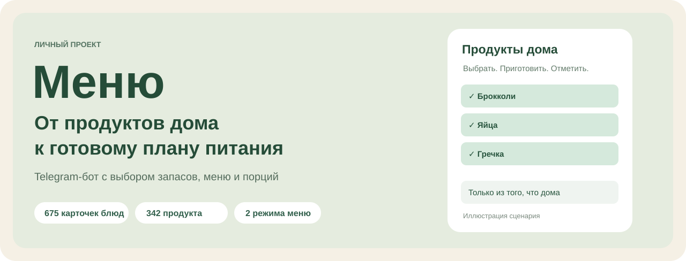
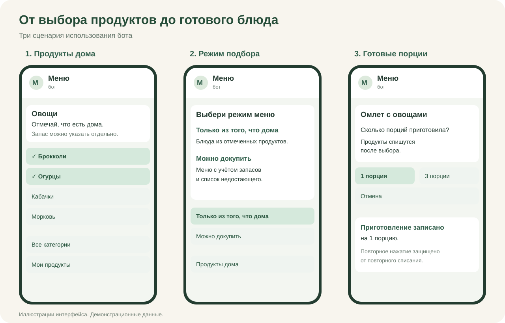

# Меню

### Telegram-бот для домашнего питания

Личный проект, который помогает выбирать блюда из продуктов дома, планировать меню и обновлять запасы после готовки.

**Рабочий прототип · Закрытая реализация**

## Задача

Мне хотелось каждый день получать разнообразное меню из своей базы рецептов и выбирать блюда с учётом продуктов, которые уже есть дома. Без необходимости каждый раз вручную просматривать сборники и составлять список покупок.

Так появился «Меню»: бот в привычном Telegram, где можно отметить продукты, выбрать режим подбора и получить меню с рецептами.

## Что умеет бот

| Возможность | Как это работает |
| --- | --- |
| Продукты дома | Выбор галочками по категориям. При необходимости можно указать количество. |
| Только из того, что дома | Подбирает блюда из отмеченных продуктов. Если подходящего блюда нет, сообщает об этом. |
| Можно докупить | Учитывает запасы и показывает недостающие продукты для выбранного меню. |
| Порции | Карточки содержат количества на одного человека и на троих. |
| Приготовила | Предлагает выбрать 1 или 3 порции и списывает измеренные запасы после выбора. Повторное нажатие не повторяет списание. |
| Замены | Предлагает до трёх подходящих замен блюда с учётом выбранного режима. |
| Больше не предлагать | Исключает блюдо и его дубли из будущих предложений. Исключение можно отменить. |
| Время приготовления | Показывает ориентир с учётом подготовки и ожидания. |
| Нутриенты | Ориентировочные КБЖУ, клетчатка и доступные витамины и минералы на человека и на троих. Неполные расчёты подписаны. |
| Ежедневное меню | Отправка в выбранное время, пока процесс бота работает. |
| Несколько пользователей | Подключение по приглашениям. У каждого свои запасы, исключения, меню и время отправки. |

## Как выглядит сценарий

*Иллюстрации интерфейса на демонстрационных данных.*

1. Отметить продукты, которые есть дома.
2. Выбрать «Только из того, что дома» или «Можно докупить».
3. Получить меню, открыть рецепт и при желании выбрать замену.
4. После готовки нажать «Приготовила» и выбрать 1 или 3 порции.

## Моя роль

Я придумала проект из собственной бытовой задачи и определяла, каким должен быть результат:

- сформулировала требования к меню, порциям и использованию домашних запасов;
- собрала исходные материалы для личной базы рецептов;
- выбирала функции и уточняла сценарии по мере использования;
- проверяла удобство бота и предлагала изменения: выбор продуктов по категориям, два режима подбора, списание порций и исключение блюд;
- определила название и визуальный образ проекта.

Моя часть работы — постановка задачи, продуктовые решения, обратная связь и проверка результата.

## Масштаб текущей версии

| Показатель | Значение |
| --- | ---: |
| Карточки блюд и перекусов в личной базе | 675 |
| Продукты в каталоге | 342 |
| Категории продуктов | 18 |
| Справочные профили для расчёта нутриентов | 250 |
| Автоматические тесты | 65 |

Это размер текущего прототипа. Часть карточек — соусы, десерты, гарниры и перекусы; для меню на день бот учитывает назначение блюда.

## Решения, которые были важны

**Планирование и приготовление разделены.** Просмотр или обновление меню не меняет запасы. Списание происходит после выбора порций в действии «Приготовила».

**Режим без покупок работает отдельно.** Бот не подставляет блюдо с отсутствующим ингредиентом, чтобы любой ценой заполнить день. При указанном количестве проверяется общий расход продуктов на выбранные блюда.

**Неизвестные значения остаются неизвестными.** Если количество продукта не указано или единицы измерения не совпадают, бот просит уточнить остаток. При неполных данных о составе он показывает сумму учтённой части рецепта.

**Предпочтения и запасы принадлежат пользователю.** Исключение блюда одним человеком не меняет предложения для другого.

## Технологии и проверка

Python, Telegram Bot API, локальное хранение в JSON, автоматические проверки на `unittest`.

В тестах проверяются пересчёт порций, общий расход запасов, режим без покупок, защита от повторного списания, исключения блюд, разделение данных пользователей и расчёт нутриентов. Последний локальный прогон: **65 тестов пройдены, 15 ноября 2026 года**.

Для пищевой ценности используется [USDA FoodData Central, SR Legacy](https://fdc.nal.usda.gov/download-datasets/), с возможностью добавить состав своего продукта с упаковки.

## Текущее состояние и ограничения

- Это личный работающий прототип. Доступ к боту предоставляется по приглашению.
- Постоянный сервер и автозапуск пока не настроены. При остановке процесса ежедневная отправка не работает.
- Время приготовления оценивается по рецепту или способу готовки.
- Нутриенты рассчитаны по исходным ингредиентам и справочным порциям. Бренд, жирность, размер продукта и приготовление влияют на результат.
- Для части продуктов нужны данные с упаковки или уточнение количества. Полного расчёта всех нутриентов для каждого рецепта пока нет.
- Индивидуальные цели питания и исключения отдельных продуктов пока не настроены.

## О публичных материалах

Этот репозиторий — портфолио проекта: описание, визуальные материалы и сценарии использования. Здесь опубликованы только специально подготовленные материалы витрины.

Программная реализация, сборники и тексты рецептов, личные запасы, история пользователей, идентификаторы чатов и ключи доступа хранятся отдельно.

Подробности: [что входит в публичную витрину](PUBLIC_SCOPE.md).
